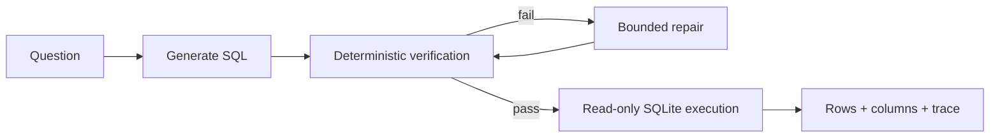

# Semantic Text-to-SQL

A local text-to-SQL system with schema grounding, deterministic verification, bounded repair, and read-only execution.

## Demo

```cmd
run-demo.cmd
```

The Streamlit demo puts the question, generated SQL, verification trace, execution result, and table output on one screen. The default **Demo (offline)** provider needs no Ollama or API key.

```text
Question
  ↓
Generate SQL
  ↓
Verify ── failure ──→ Repair (bounded)
  ↓ pass                  │
Execute read-only ←───────┘
  ↓
Rows + trace
```

Try:

```text
How many orders were placed in 2024?
```

The built-in offline provider demonstrates the service flow only; benchmark claims below come from frozen local-model artifacts.

## Results

The checked-in frozen paired summary covers **100 BIRD DEV queries** using local `qwen3.5:9b-q4_K_M` through Ollama:

| Metric | Direct | Guarded + repair |
|---|---:|---:|
| BIRD EX-compatible match | 33% | **39%** |
| Execution success | 75% | **90% (conservative)** |
| EX wrong → correct | — | **6** |
| EX correct → wrong | — | **0** |

The guarded path recovered **6 correctness failures** with no correct-to-wrong EX regressions, and conservatively recovered **15 direct execution failures**. The raw guarded execution-success count was 91/100, but one capped result invalidated that row for strict comparison, so the resume-facing figure is 90/100.

Source of truth: [`runs/qwen9b-frozen100/summary.json`](runs/qwen9b-frozen100/summary.json). The local scorer follows the pinned BIRD evaluator's set-of-tuples execution-match contract at revision `483554eae102996f5ec1f4feab4e78ef29c2a394`.

> [!IMPORTANT]
> The summary's provenance points to workflow run `37307108955`, but that workflow did **not** finish as a clean end-to-end success: one treatment shard failed and the aggregate job was skipped. The checked-in summary is therefore the current project evidence artifact, not proof of a successful canonical workflow execution. A clean end-to-end rerun remains outstanding.

## Semantic revision ablation

A later frozen-100 experiment tested a conservative one-pass semantic reviewer on top of the same Qwen 9B guarded outputs. The reviewer checked projection, aggregation/grain, joins, filters/literals, and ordering/top-k semantics, then re-verified any patch before execution.

| Frozen-100 | Guarded baseline | + Semantic revision |
|---|---:|---:|
| BIRD EX-compatible match | **39%** | 38% |
| Conservative execution success | **90%** | **90%** |
| Wrong → correct | — | 0 |
| Correct → wrong | — | 1 |

The semantic layer produced **no positive EX rescue and one regression**, so it is kept as an experiment rather than part of the headline/default path. This is the main reason the project stays with the simpler guarded pipeline.


### Experimental Semantic Layer v2 (opt-in; no training)

The default guarded Qwen 9B system remains unchanged. The old LLM-only
`semantic_revision=True` regressed 39% → 38% on the frozen100 cohort,
so the new evidence-gated `semantic_v2=True` is a **separate** opt-in path.

First implemented capability: correcting **one mismatched quoted string value**
in a simple one-table SQL equality predicate. The layer requires all of:

1. Exactly one unambiguous, explicitly quoted entity in the original question.
2. That exact entity exists in the **same physical SQLite table/column** that
   the SQL currently filters using a different string value.
3. The proposal changes exactly that SQLGlot AST literal (no join/aggregate/
   projection/ordering rewrites).
4. A synthetic **in-memory** SQLite counterexample shows differing SQL outputs,
   and the normal read-only compile preflight passes.

Otherwise the original guarded SQL executes unchanged. The counterexample
demonstrates changed behavior, **not** semantic correctness: matching the
request requires stronger independent evidence. No model calls, no training,
no writes to the real database, no gold SQL available to the selector.
The experimental semantic v2 node is incompatible with the previous
`semantic_revision` option to prevent stacking two unproven interventions.

```bash
python -m pip install -e ".[semantic-v2]"
```

```python
service = SemanticSQLService(
    "my.db", provider=provider, max_repairs=2, semantic_v2=True,
)
result = service.ask('Find the event "October Meeting"')
# inspect the semantic_v2 stage to see whether and why a change was accepted
```

See `tests/test_semantic_v2.py` for guardrails and
`evaluation/semantic_v2_frozen_pilot.py` for frozen original-Qwen9B
baseline-vs-v2 validation. **Do not promote based on focused tests alone**.
This first release is deliberately narrow: complex joins, grouping/grain,
unquoted synonyms, and ranking semantics are audit-only/unsupported.
The baseline 39% claim is unchanged until an independently verified gain.


### Separate XiYan grounding ablation

A separate frozen-100 experiment tested **Decomposed Grounded Schema Linking (DGSL v1)** with XiYanSQL 7B and a project-local set-equality execution scorer. This is a **different model and scorer** from the Qwen3.5 table above, so the numbers are not directly interchangeable.

| XiYan frozen-100 | Lexical baseline | DGSL v1 |
|---|---:|---:|
| Frozen execution match | **58/100** | **58/100** |
| Wrong → correct | — | 7 |
| Correct → wrong | — | 7 |
| Success gate | — | 61/100 |
| Gate met | — | **No** |

DGSL improved schema-context precision and observable value grounding, but the gains were offset by regressions and produced **no net correctness gain**. See [the DGSL experiment note](docs/dgsl-experiment.md) and [the compact frozen result](runs/xiyan-dgsl-frozen100/summary.json).

## Two failures worth inspecting

The aggregate numbers hide the most important engineering lesson: **a query becoming executable is not the same thing as becoming correct**.

### 1. Repair can recover execution without recovering meaning

**BIRD case 430 · `card_games`**

The direct query referenced a nonexistent `cardKingdoms` table and failed to execute. The guarded path caught the compile failure, repaired the SQL once, passed verification, and executed successfully — but the final query still failed the BIRD EX-compatible execution match.

```text
Direct
  → execution failed: no such table: cardKingdoms

Guarded
  → verify: sqlite_compile_error
  → repair attempt 1
  → verify: PASS
  → execute: rows=0
  → EX-compatible match: false
```

**Takeaway:** bounded repair is useful for operational reliability, but a successful execution is not evidence that the model understood the question.

### 2. Some wrong answers look completely healthy

**BIRD case 1366 · `student_club`**

For “List all the members who attended the event `October Meeting`,” the generated SQL passed deterministic verification and returned 23 rows. Both direct and guarded paths executed successfully, yet the BIRD EX-compatible execution match was false.

```text
verify: PASS
execute: rows=23
status: OK
EX-compatible match: false
```

**Takeaway:** deterministic checks can reject unsafe or invalid SQL; they cannot prove semantic correctness.

These two examples come from an earlier frozen 4B run and illustrate the same failure distinction; they are not part of the 9B headline table.

## Architecture



An optional semantic-review path remains available for experimentation, but the frozen ablation above did not justify enabling it by default.

## Engineering choices

- **Deterministic checks before execution** instead of asking another model to judge obvious compiler or safety failures.
- **Bounded repair** with `max_repairs=2`, avoiding an open-ended agent loop.
- **Read-only SQLite execution** so generated SQL cannot mutate the database.
- **Schema grounding** keeps the default generation path tied to the actual database surface.
- **Experimental value grounding** exists in separate grounding/DGSL experiments; it is not part of the default `SemanticSQLService` path.
- **One service layer** behind Streamlit, FastAPI, and CLI.
- **Paired evaluation** keeps reliability and correctness claims tied to the same frozen cases.
- **Ablation before adoption**: semantic planning/revision ideas are kept only when they show positive net evidence.

## Quickstart

### Offline visual demo

```bash
uv sync
uv run streamlit run app.py
```

The default offline mode uses the bundled SQLite demo database and requires no model download or API key.

### Local-model path

```bash
ollama pull qwen3.5:4b
uv run streamlit run app.py
```

Choose **Ollama** in the sidebar.

### Optional semantic revision in Python

```python
service = SemanticSQLService(
    "my.db",
    provider=provider,
    semantic_revision=True,
)
```

### CLI

```bash
uv run semantic-sql ask "Which customer spent the most?"
```

### FastAPI

```bash
uv run uvicorn semantic_sql.api:app --reload
```

## Evaluation note

> [!IMPORTANT]
> **Execution success is not Text-to-SQL accuracy.** A query can execute successfully and still answer the wrong question. The 90% figure represents conservative execution reliability, while the EX-compatible metric is the correctness-oriented execution-match measure used here. The semantic-revision ablation did not improve it, so the simpler guarded path remains the headline result.

## Limits

- Frozen headline evaluation is a 100-query BIRD DEV sample, not the full benchmark.
- The current checked-in 9B summary does not yet have a clean successful end-to-end workflow rerun behind it.
- SQLite only in the current implementation.
- Results depend on the frozen local-model configuration.
- The optional semantic revision adds one extra model call when enabled and did not improve the frozen-100 EX-compatible result.
- The offline provider is demo infrastructure, not evaluation evidence.
